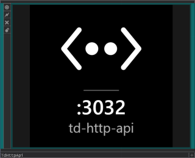

# TdHttpApi: an agent bridge for TouchDesigner

Drop `TdHttpApi.tox` into any TouchDesigner project and AI coding agents (Claude Code, Codex,
Copilot, …) can see, build and debug your live network. They connect over plain HTTP (curl) or MCP.

- **Look:** network structure, parameters, errors (with GLSL compile logs), snapshots of any node,
  and pixel stats.
- **Change:**
  - build whole networks in one call
  - set many parameters at once
  - make exact text edits to DATs
  - run Python as a last resort
- **Safe by default:**
  - Every agent change is one undo step.
  - Browsers can't reach it.
  - Changed nodes flash so you can see what the agent did.
  - Deletes can optionally ask for confirmation.
- **Watch it work:** a live dashboard at `http://127.0.0.1:3031/ui`.
- **Several apps at once:** each bridge takes the next free port (3031–3040) and shows it, with its label, in
  the COMP's viewer.

## Quick start

1. Download `TdHttpApi-vX.Y.Z.tox` from the [latest GitHub release](https://github.com/cacheflowe/td-http-api/releases/latest) and drag it into your project.
2. On the COMP, pulse **Copy Prompt** and paste the result into your agent.
3. [Optional] Pulse **Open Dashboard** to watch what the agent does.

Nothing to register: agents use plain HTTP, and TouchDesigner's own docs are built in (`/help`).
MCP is there if you want it (`/mcp`); see "HTTP or MCP?" in the skill.

The tox writes nothing into your project unless you ask. The OP Snippets catalog and docs index it
builds from your TD install are cached in your user TD preferences folder (`GET /cache`). Full list: "What the tox writes to
disk" in [skills/td-http-api.md](skills/td-http-api.md).

## Optional: TouchDesigner skills for your agent

The bridge already serves its agent docs over HTTP (`/init`, `/docs`), so none of this is required.
If you want your coding agent to carry the same TouchDesigner know-how in every session, even
before it connects, install the skills in [skills/](skills/):

| Skill | What it teaches |
|---|---|
| [td-http-api](skills/td-http-api.md) | Every bridge route, the error contract, and lessons from building networks through it |
| [td-network-craft](skills/td-network-craft.md) | Idiomatic network building, learned from Derivative's OP Snippets |
| [td-common-mistakes](skills/td-common-mistakes.md) | TouchDesigner Python traps (parameter names, `.val` vs `.eval()`, threading, …) |

Each file is a standard skill (Markdown with `name` and `description` frontmatter). For Claude Code,
copy one to `~/.claude/skills/<name>/SKILL.md` (every project) or `<project>/.claude/skills/<name>/SKILL.md`
(one project). Other agents (Codex, Copilot, Cursor) have their own folders for skills or
instructions; the files work there as-is.

(`skills/td-agent-init.md` is the start-up prompt the COMP's **Copy Prompt** button gives you, not a
skill to install.)

Full user guide: [src/TdHttpApi_README.md](src/TdHttpApi_README.md). Agent/route reference:
[skills/td-http-api.md](skills/td-http-api.md).

## Developing

Open `td-http-api.toe`. The bridge COMP's DATs are file-synced to `src/` and `skills/`, so edits go live
immediately. See [CLAUDE.md](CLAUDE.md) for the workflow and checks. Releases: see
[docs/RELEASING.md](docs/RELEASING.md).
